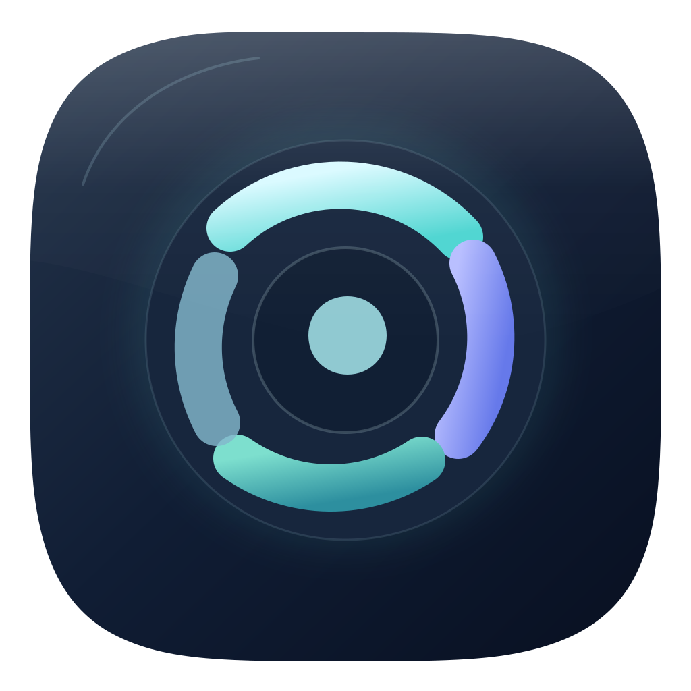
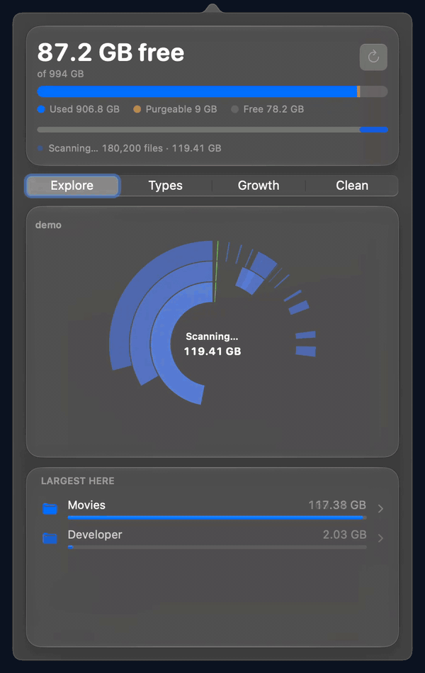
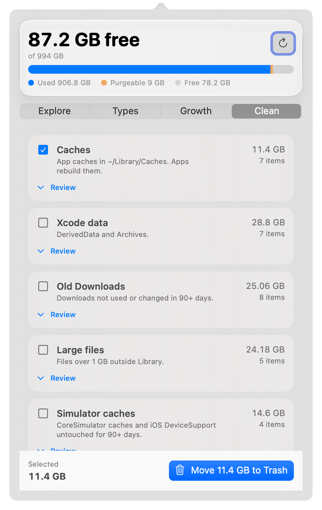
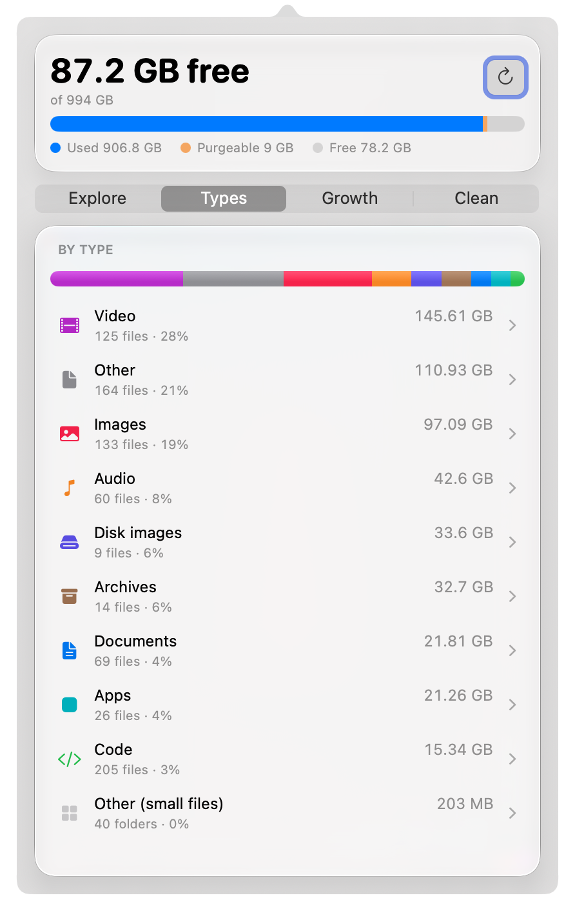

<p align="center">
  
</p>

<h1 align="center">DustBar</h1>

<p align="center">
  <strong>See what fills your disk. Clean it with care.</strong><br>
  A tiny native macOS menu bar app that shows where your space went and removes things only after you review them.
</p>

<p align="center">
  
  
  
  
  
</p>

<p align="center">
  <picture>
    <source media="(prefers-color-scheme: dark)" srcset="docs/assets/menubar-dark@2x.png">
    
  </picture>
</p>

<p align="center">
  
  &nbsp;
  <picture>
    <source media="(prefers-color-scheme: dark)" srcset="docs/assets/clean-dark@2x.png">
    
  </picture>
  &nbsp;
  <picture>
    <source media="(prefers-color-scheme: dark)" srcset="docs/assets/types-dark@2x.png">
    
  </picture>
</p>

<p align="center"><sub>Screenshots use synthetic demo data.</sub></p>

> **Heads up:** current builds are signed locally and are **not notarized** (not yet). Apple silicon, macOS 15 or later. Intel is not supported (untested).

## Features

- **Menu bar ring** with free space in GB. Amber below 15% free, red below 5%, with an optional low-disk alert.
- **Explore**: a sunburst that fills in live while scanning, a "Largest here" list, and drill-down into any folder.
- **Types**: space by file type (video, images, audio, archives, documents, code, apps).
- **Growth**: what grew since earlier scans.
- **Clean**: caches, Xcode, simulators, logs and crash reports, developer caches, stale `node_modules`, old Downloads, large files, duplicates, and Time Machine local snapshots. Review each item before anything moves.
- **Fast to open**: the last scan is cached for an instant first view, and refresh rescans only folders that changed.
- **Settings** (⌘, from the menu bar item): excluded folders, scan scope (home folder, or whole disk in browse-only mode), alert threshold, and a reminder (default weekly) that never deletes anything.

## Safety

Cleaning is a short, explicit path.

| Step | What happens | Reversible |
|---|---|---|
| 1. **Review** | Every item is listed with its size and location. Nothing moves until you select it and confirm. | n/a |
| 2. **Move to Trash** | Selected items go to the Trash. | Yes, undoable |
| 3. **Empty Trash** | Confirmed separately. Removes only direct children of `~/.Trash`. | **No, permanent** |
| 4. **Delete a Time Machine local snapshot** | Confirmed separately. Runs `tmutil deletelocalsnapshots` for the chosen snapshot. | **No, permanent** |

Items already in the Trash are never moved again. Symlinks are not followed.

DustBar deletes only what you select and confirm, in Clean or from the Explore list, and only outside the denylist.

**Protected paths** are never cleaned, whatever the scan finds:

- System locations: `/System`, `/usr`, `/bin`, `/sbin`, `/private`, `/Library`, `/Applications`.
- Under the home folder: `Library/Keychains`, `Library/Mail`, `Library/Messages`, `Library/Mobile Documents`, `Library/Application Support`, `Library/Containers`, `Library/Group Containers`, `Library/Preferences`, `Library/CloudStorage`, `Library/Safari`, `Library/Cookies`, `Library/Calendars`, `Music`, `.ssh`, `.gnupg`, `.aws`, and the Dropbox, Google Drive, OneDrive, and iCloud Drive (Archive) folders.
- The home folder itself, `Library`, `.Trash`, `Desktop`, `Documents`, `Downloads`, `Pictures`, `Movies`, `Library/Caches`, `Library/Developer`, and `Library/Logs`. Their contents can still be reviewed when a specific rule applies to them.
- App bundles.

## Privacy

- **No network.** DustBar makes no network connections.
- **No telemetry, analytics, or accounts.**
- **No dependencies.** The package has no third-party code.
- **What is stored on disk.** Scan data lives in `~/Library/Caches/com.megasoft78.dustbar/` (`tree.bin`, `history.json`); settings are in the standard preferences plist.
  - `tree.bin`: the last scanned size tree, so the first view opens instantly. A fresh scan always follows.
  - `history.json`: scan totals over time, used by Growth.

## Install

Requires macOS 15 or later on Apple silicon (arm64). Intel is not supported (untested).

### 1. Homebrew (recommended)

```sh
brew install --cask megasoft1978/dustbar/dustbar
```

Homebrew taps `megasoft1978/homebrew-dustbar` automatically the first time you run this.

- Upgrade: `brew upgrade --cask dustbar`
- Uninstall: `brew uninstall --cask --zap dustbar`

The cask clears the quarantine flag itself, so the first launch needs no Gatekeeper step. The build is still signed locally, not notarized.

### 2. Download the DMG

[Download the DMG](https://github.com/megasoft1978/dustbar/releases/latest) from the latest release. The file is `DustBar-<version>.dmg` (a `.zip` is also provided). Open the DMG and drag **DustBar** to **Applications**.

> **Gatekeeper.** Current builds are locally signed and **not notarized**, so macOS warns on first launch. Either right-click `DustBar.app` in Applications, choose **Open**, then confirm, or run:
>
> ```sh
> xattr -dr com.apple.quarantine /Applications/DustBar.app
> ```

### Full Disk Access

For complete scans, open System Settings > Privacy & Security > Full Disk Access, add `/Applications/DustBar.app` and enable it. Without it, folders macOS protects are skipped and sizes are incomplete. After a reinstall or rebuild without the same local signing identity, macOS may ask again.

- **Launch at login.** Right-click the menu bar item and choose Launch at Login.
- **Uninstall.** Homebrew: `brew uninstall --cask --zap dustbar`. Otherwise quit DustBar, then run `rm -r /Applications/DustBar.app ~/Library/Caches/com.megasoft78.dustbar ~/Library/Preferences/com.megasoft78.dustbar.plist`. Either way, remove DustBar from Full Disk Access and Login Items.

## Benchmarks

Measured with the scripts in this repository on a Mac17,14 (Apple M5 Max, 18 cores), macOS 27.0.1, on 2026-10-23. **Warm cache**: no `sudo purge`, so numbers reflect a warm disk cache. Your machine and disk will differ. Raw values: [`docs/benchmarks.json`](docs/benchmarks.json).

| Metric | Result | How it is measured |
|---|---|---|
| Binary size | 996,432 bytes (about 1.0 MB) | `stat` of `build/DustBar.app/Contents/MacOS/DustBar` after `scripts/bundle.sh` (release, stripped, ad-hoc signed) |
| Idle memory (physical footprint) | 15.1 MB | Fresh copy via `open -n`, popover closed, `vmmap -summary` after 61 s idle |
| Idle CPU | 0.0 % | Mean of `ps -o %cpu=` sampled every 5 s over the idle window |
| Full scan, `~/Library` | 5.31 s, 1,073,445 files | `DUSTBAR_SCAN_BENCH=~/Library swift test --filter scanBench` |
| Full scan, whole home folder | 35.35 s, 8,588,615 files | `DUSTBAR_SCAN_BENCH=~ swift test --filter scanBench` |
| Incremental refresh | ~40x for 20 changed folders on `~/Library` (0.131 s vs 5.26 s full) | `DUSTBAR_REFRESH_BENCH=1 swift test --filter refreshBench` |

The 5-minute idle footprint has not been recorded yet. A single benchmark is never enough: treat these as a reference point, not a promise.

## Architecture

```
Sources/DustBar/
├── App/    AppDelegate, main, StatusController (menu bar ring, refresh policy),
│           SettingsWindow, Settings, CleanupReminder, LowDiskAlert, DemoMode, ShellSupport
├── Core/   Scanner, Monitor, TreeCache, Rules, Cleaner, Duplicates, Snapshots,
│           History, FileTypes, Models, DemoFixture
└── UI/     PopoverView, SunburstView, TopList, CleanView, TypesView, GrowthView, SettingsView
```

- **Scanner** (`Core/Scanner.swift`): parallel `getattrlistbulk` walk. Allocated sizes, hard links counted once, one device only, symlinks not followed. Post-order pruning folds directories below a size threshold (1 to 5 MB, scaled to the volume) into "(small files)". Live snapshots of the top three levels are published about once a second. A readdir fallback handles non-APFS volumes.
- **Incremental refresh**: when the popover opens, only folders that changed are rescanned, if they can be identified. Otherwise a full scan runs. A full rescan also runs at least once every 24 hours.
- **Monitor** (`Core/Monitor.swift`): `FSEvents` stream on the home folder with 30 s latency. Free-space statistics are read every 60 s. No background polling beyond these.
- **TreeCache** and **History**: the cached tree and the scan history in the caches folder.
- **Rules**: the protected-path denylist and the cleanup rules. **Cleaner** acts only through these rules and the Trash, with the single permanent exception of Empty Trash. **Snapshots** wraps `tmutil` for Time Machine local snapshots.
- **Duplicates** and **FileTypes**: duplicate detection and file-type classification.
- **Settings** and **CleanupReminder**: preferences and the reminder (default weekly).
- **Icon**: `design/AppIcon.svg`, rendered with `scripts/make-icon.sh`.

## Development

```sh
swift test                                   # unit tests
bash scripts/measure.sh                      # refresh docs/benchmarks.json (--long, --full for extra fields)
DEMO=1 bash scripts/bundle.sh                # demo app with synthetic data, built separately
bash scripts/capture/capture.sh              # screenshots, GIF and videos from the demo app
bash scripts/check-public-assets.sh          # privacy check before publishing docs/ or README.md
```

- Demo data is synthetic. It may appear only in public assets, never in code paths used by the real app. The demo build never compiles into the normal app or into release builds.
- `scripts/check-public-assets.sh` checks for local absolute paths, user names, media metadata, and home-folder names visible in screenshots.

## Limits

- Apple silicon only in testing. macOS 15 or later. Intel is untested, and `UNIVERSAL=1` is not verified.
- Locally signed, not notarized. Builds from other sources may trigger Gatekeeper prompts.
- Without Full Disk Access, protected folders are skipped and sizes are incomplete.
- Scans count allocated size on one device. Other volumes are not included.
- A full scan of a large home folder takes tens of seconds (35 s on the benchmark machine, warm cache).
- The popover can show a slightly stale view. `FSEvents` batches changes with 30 s latency.
- Whole-disk scope is browse-only. Cleanup is limited to the home folder.
- Protected paths cannot be cleaned, so some space shown in Explore may not be reclaimable here.
- Time Machine snapshot deletion is permanent and bypasses the Trash.
- Growth needs earlier scans before it shows changes.
- Duplicate detection and large-file rules are heuristics. Review each item before confirming.
- Non-APFS volumes use the readdir fallback, which is slower.
- No automatic updates.

## Contributing

- Keep dependencies at zero. Do not add packages, frameworks, or network code.
- Safety rules are not negotiable: no change may widen the protected-path denylist in `Core/Rules.swift`, add a permanent-delete path, or act outside the Trash except through the two confirmed flows above.
- Do not weaken tests, thresholds, or benchmark oracles to make a change pass. Add tests for new behavior, and run `swift test` before opening a pull request.
- Benchmark numbers in this README must come from `docs/benchmarks.json`, regenerated with `scripts/measure.sh`.

## License

MIT. See [LICENSE](LICENSE). Copyright (c) 2026 Gabriele Ferreri.
